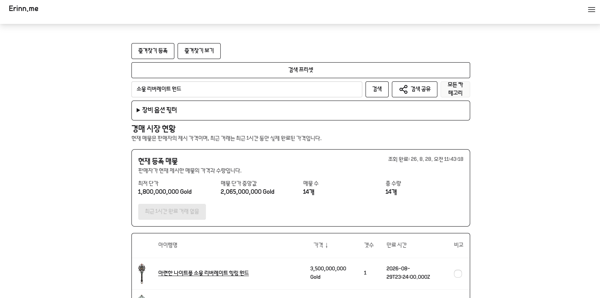

<div id="top"></div>


<!-- PROJECT LOGO -->
<br />
<div align="center">
  <a href="https://github.com/sweatpotato13/erinn.me"></a>

<h3 align="center">Erinn.me</h3>

  <p align="center">
    A project utilizing Mabinogi's OpenAPI to proview market, horn and more
    <br />
    <a href="https://erinn.me">View Demo</a>
    ·
    <a href="https://github.com/sweatpotato13/erinn.me/issues">Report Bug</a>
    ·
    <a href="https://github.com/sweatpotato13/erinn.me/issues">Request Feature</a>
  </p>
</div>


### Screenshots

<br>

<br>

### Built With

* [pnpm](https://pnpm.io)
* [Next.js](https://nextjs.org/)

<p align="right">(<a href="#top">back to top</a>)</p>


<!-- GETTING STARTED -->
## Getting Started

This is an example of how you may give instructions on setting up your project locally.
To get a local copy up and running follow these simple example steps.

### Installation

1. Clone the repo
   ```sh
   git clone https://github.com/sweatpotato13/erinn.me.git
   ```

2. Install dependencies
   ```sh
   pnpm install
   ```

3. write .env file
   ```sh
   cp .env.example .env
   nano .env
   ```

4. Start the development server
    ```sh
    pnpm dev
    ```

5. or build and start the production server
    ```sh
    pnpm build
    pnpm start
    ```

### End-to-end tests

Playwright starts `pnpm dev` on port 3000 before running specs. By default it
does **not** reuse an existing server, so another app on 3000 will not be tested
by mistake. If you already run this project on 3000, opt in with:

```sh
PW_REUSE_SERVER=1 pnpm exec playwright test
```

Install browsers once with `pnpm exec playwright install chromium` (or
`--with-deps` in CI).

### Reference data

Maintainers can run `pnpm data:collect` to refresh the committed Korean game
reference snapshot and `pnpm data:check` to validate it without network access.
Collection is separate from normal development and production builds.

After refreshing the snapshot, run `pnpm prebuild` to regenerate every consumer
index, then run `pnpm data:check`. Review, commit and roll back the generated
indexes together with their source.
See [enchantment reference data](docs/enchant-reference.md) for supported effects,
identity matching and migration notes.

1. Install Chromium once with `pnpm exec playwright install chromium` after
   installing the project dependencies.
2. Start with a clean `src/data/reference` directory in Git, then run
   `pnpm data:collect`, `pnpm prebuild` and `pnpm data:check`.
3. Review `git diff -- src/data/reference`, including the source version,
   warnings, counts and checksums in `manifest.json`, and the changed rows in
   `snapshots/*.json`. Commit approved updates together:
   `git add src/data/reference && git commit -m "chore(data): Refresh reference data"`.
4. To discard an uncommitted refresh, run
   `git restore --source=HEAD --staged --worktree -- src/data/reference`.
   To restore an earlier committed version, replace `HEAD` with the desired
   commit, run `pnpm data:check`, and commit the restored manifest and tables
   together. Inspect `git status` for new, untracked files; restore does not
   remove those.

The barter planner derives fixed goods with `pnpm barter:build`. Run
`pnpm barter:refresh` to collect the season, rebuild the catalog and save local
material icons together. Its separate `pnpm barter:season:collect` command
refreshes the reviewed Labanyu seasonal supplement locally; builds and page
requests never run source collectors.
See [barter reference data](docs/barter-reference.md) for the monthly refresh,
verification and review/commit workflow.

Downstream scripts can call
`readSnapshot(resolve("src/data/reference"))` from `scripts/reference-data.ts`
to load and validate `{ manifest, data, warnings }` without network access.
Application features should derive only the records they need from the committed
JSON files; avoid bundling the entire dataset or importing this Node-only helper
into client code. Source field names, array order, duplicates and placeholders
are preserved. If collection stops with a stale `.collect-lock`, inspect its
`previous-snapshots` backup and restore files matching the active manifest before
removing the lock; do not delete a backup merely because its process has exited.

### Rate-limit deployment

The API proxy trusts only Vercel's `x-vercel-forwarded-for` header for client
identity and ignores `x-forwarded-for`. Any reverse proxy placed in front of
Vercel must strip client-supplied `x-vercel-forwarded-for` values before
forwarding requests.

Configure a single Vercel Firewall rule with condition `@vercel/firewall`:

| Setting | Value |
| --- | --- |
| Rate Limit ID | `erinn-api` |
| Window | Fixed, 60 seconds |
| Limit | 120 requests |
| Key | API controlled (proxy passes `rateLimitKey` from `x-vercel-forwarded-for`) |
| Action | 429 Too Many Requests |

`src/proxy.ts` calls `checkRateLimit("erinn-api", …)` with a 1500 ms timeout.
When the WAF check errors, times out, or the rule is missing:

- **Fail closed** (HTTP 503, `Retry-After: 60`): `POST /api/contact` and
  `POST /api/murias-relics` (mail and cache-bust routes).
- **Fail open** (request continues): all other rate-limited routes (`/api/*`
  except the two POST routes above, and `/calculator/preview`).

Each unavailable check emits one structured log line:
`{"event":"rate_limit_unavailable","reason":"not-found"|"blocked"|"timeout"|"error","method","path","failClosed"}`.
Normal 429 responses are not logged.

Verify production after deploy:

```sh
curl -sI "https://erinn.me/api/suggest?q=test" | grep -i x-ratelimit-limit
```

The response must include `x-ratelimit-limit: 120`. If the header is missing,
the firewall rule is absent or not matching; look for `"reason":"not-found"` in
deployment logs.

Local development and Vercel Preview deployments bypass WAF checks entirely
unless preview rate limiting is enabled (below).

To verify the Production WAF path before merging to `main`:

1. Add `ENABLE_PREVIEW_RATE_LIMIT=true` to the Preview environment, scoped to
   the `develop` branch, and redeploy it.
2. Request a protected API route and confirm it returns HTTP 200 with an
   `X-RateLimit-Limit: 120` header.
3. Remove `ENABLE_PREVIEW_RATE_LIMIT` after verification and redeploy
   `develop` to restore the default Preview bypass.

Never add `ENABLE_PREVIEW_RATE_LIMIT` to Production: Production always applies
the WAF regardless of this variable.

<p align="right">(<a href="#top">back to top</a>)</p>
